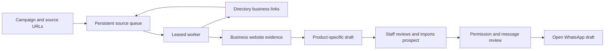

# EmberWeb Client Workspace

An isolated Next.js workspace for EmberWeb's inquiry pipeline, discovery scheduling, proposals, invoices, PayFast reconciliation, and delivery tracking. The public marketing site remains a separate Vercel project.

## Local setup

1. Copy `.env.example` to `.env.local` and fill in the Supabase publishable key. Keep `SUPABASE_SECRET_KEY` (or its legacy service-role fallback) and all PayFast credentials server-only.
2. Apply the numbered migrations in `supabase/migrations` to project `hbdxhbwufgkrwqxpieds`.
3. Add `http://localhost:3000/auth/callback` to Supabase Auth's allowed redirect URLs.
4. Run `pnpm install`, then `pnpm dev`.

The initial allowlist contains only `joshmoodley01@gmail.com`. Supabase Auth must already have a verified user for that email before passwordless sign-in can succeed.

Staff inquiry notifications use the server-only `RESEND_API_KEY` and the optional bare `RESEND_FROM_EMAIL` address. Production uses a sender address on a domain verified in Resend; the sender setting does not connect an inbox or configure Supabase Auth confirmation emails. Keep customer registration paused until Supabase SMTP is configured and a confirmation email is verified end to end.

## Outreach studio

`/admin/outreach` keeps independently sourced prospects separate from inbound inquiries. Apply `20261016142553_outreach_prospects.sql` only to the approved workspace project. The existing staff allowlist and admin RLS control access; public and anonymous roles have no prospect access.

The internal dashboard at `/admin` also summarizes the latest 250 saved outreach prospects, current permitted drafts awaiting review, staff-recorded replies and bookings. It shows the five most recently updated prospects and links directly to the private entry form and saved list. Outreach loads independently so a lookup/storage problem does not hide enquiries, finance or delivery. Password sign-in opens this central dashboard. Google research results remain transient; the summary shows independently saved records only.

Live lookup uses the official Places API (New) Text Search with a server-only `GOOGLE_PLACES_API_KEY` Vercel Secret. Use a separate Google Cloud project, restrict the key to Places API (New), enable billing yourself when required, and set provider quotas. The app permits ten searches per admin per hour, at most ten results per search. Website/phone fields use the Enterprise search SKU; verify current Google pricing before enabling. Never set a `NEXT_PUBLIC_` Places key or reuse another app's key. Search results stay in memory and are not written into prospect records. Keep Google's attribution and `/outreach/terms` links visible.

The studio generates industry-based concept starting points and a manually reviewed WhatsApp click-to-chat draft. It never automatically sends a message or marks a draft as sent. A valid number, documented permission and operator review are required; do-not-contact records cannot open the draft. The public `/demo` contains an explicitly illustrative interactive concept and `/outreach/emberweb-demo.mp4`, a 16-second silent clip generated by `scripts/render-outreach-demo.py`.

Google Calendar remains the source for actual availability, booked appointments, calendar invitations and confirmation emails. As verified on 16 October 2026, email-code verification requires an account upgrade and remains disabled by the owner's choice. Recording an appointment in the workspace does not create a Calendar event or verify mailbox ownership. Staff-only Resend inquiry notifications are unchanged.

### Main-site staff access and daily preparation

The marketing project proxies `/outreach`, `/admin/*`, `/login`, `/setup`, staff APIs, Next assets and demo media to this app. Marketing documents keep their strict CSP; proxied Next pages use the workspace policy so they can hydrate. Payment and legacy email-link callbacks retain the existing portal canonical origin. Password sign-in uses a host-local Supabase SSR session; the optional email-link fallback fully navigates to the portal before requesting a link so PKCE cookies and callbacks stay on one host.

`/setup` activates a password for the existing confirmed owner, using a 256-bit code issued locally and stored only as a SHA-256 hash in `workspace_private.owner_activation`. The code expires after 24 hours and the service-only claim RPC consumes it atomically. The owner enters their own password; activation never creates a new user or confirms an email address. A failed Auth update after claiming requires an operator to issue a fresh code. `scripts/prepare-outreach-secrets.mjs` prepares ignored local activation instructions and a cron secret; its `wx` writes prevent accidentally overwriting existing secrets. Do not publish or paste those files into chat.

Apply `20261016144407_outreach_preparation_and_owner_activation.sql` to the approved workspace project. Store `CRON_SECRET` as a production Vercel Secret. `vercel.json` schedules `/api/cron/outreach` daily at 06:00 UTC (08:00 Johannesburg; actual start may vary with the hosting plan). The function prepares at most 50 new/changed, permission-approved research/ready prospects from a bounded batch, with one upserted preparation per prospect. Unchanged records are skipped. No Google lookup, WhatsApp message, email or appointment is created by the job. `/api/admin/outreach/prepare` provides the same preparation on demand to authenticated staff.

### Public-website research queue

Apply `20261018082345_website_research_jobs.sql` only to the approved project. Saved businesses can queue an official HTTPS homepage from the private Outreach screen; results and the latest 50 checks stay there. The API accepts a prospect ID, reloads its saved website, and permits ten queues per admin/hour and one per hostname/hour. Do-not-contact records are blocked. It never accepts an arbitrary URL from the browser or imports discovered contact details into the prospect.

`/api/admin/outreach/research/process` runs one check on demand. A separate authenticated `/api/cron/website-research` runs daily at 06:30 UTC (08:30 SAST, hosting-plan timing may vary) using the existing `CRON_SECRET`. It claims one persisted job with a two-minute lease, a fresh token and at most three crash-recovery attempts. Completion requires the current lease token; changed prospect snapshots are skipped. Research does not send messages, call Google Places, create appointments or alter finance records.

The fetcher checks robots rules, resolves and pins public IPv4 addresses, validates TLS hostnames, permits at most two same-host/www homepage redirects and fetches no deeper pages. Each check has a 25-second total deadline, 8-second read timeout, 16 KiB headers and 64/256 KiB robots/HTML body limits. It requests uncompressed content and rejects unsupported formats. HTTP-only sites, IPv6-only hosts, robots redirects, non-homepage redirects, JS-only information and login-protected content require manual review. No browser code runs and no raw HTML, cookies, discovered email addresses or phone numbers are retained. Results are bounded page metadata and contact/booking-link indicators, with timestamps and factual observations; absence of an element is not a finding that the business lacks a service or system.

Implementation references: [Node HTTPS](https://nodejs.org/docs/latest-v24.x/api/https.html), [Robots Exclusion Protocol](https://www.rfc-editor.org/rfc/rfc9309.html), [OWASP SSRF prevention](https://cheatsheetseries.owasp.org/cheatsheets/Server_Side_Request_Forgery_Prevention_Cheat_Sheet.html), [Cheerio parsing](https://cheerio.js.org/docs/basics/loading/). Only inert parsing is used; Cheerio's URL-fetching helpers are not used. Parser and Supabase dependencies are pinned, and the SDK satisfies the SSR adapter's peer requirement. The Next build/tracing root includes the repository's shared pnpm dependencies.

### Campaign scraper bot

The built-in bot is at `/admin/outreach#outreach-bot`. Apply the archive/product migration followed by `20261018093749_outreach_scraper_bot.sql` only to `hbdxhbwufgkrwqxpieds`. Campaigns select an EmberWeb or BioSync offer, contextual industry/location, a daily check budget, a total business-site cap, and one or more source URLs. A business source queues its homepage. A public HTML directory source discovers up to twenty distinct outbound business origins and queues them within the campaign's site cap. Industry and location describe the campaign; they are not an automatic web-wide search filter.

The crawler checks the public homepage and at most one linked same-site contact/about page. It stores bounded page evidence and published email and South African telephone contact values from links and supported semantic contact regions, each with its source URL and observation time. These are publicly observed contacts, not verified mailboxes or outreach permission. It never executes page scripts, crawls login pages, stores raw HTML, or bypasses robots rules. HTTPS, public DNS pinning, redirect checks, a 1 MiB research-page limit (legacy homepage audit: 256 KiB), 64 KiB robots limit and an aggregate thirty-second deadline also apply to directory discovery.

The queue lives in `outreach_bot_campaigns` and `outreach_bot_jobs`, with admin-only reads and service-only command RPCs. Claims use transactional locks, a fresh two-minute lease, and at most three attempts. A daily budget counts claims, including retries, in Johannesburg time. Active host deduplication prevents two campaigns researching the same host concurrently. Pausing invalidates running tokens. Completion rechecks the active campaign, exact unexpired lease and do-not-contact suppression before publishing or adding directory children. Transient failures retry after five/ten minutes when another invocation is available. Running the function again never sends a message or imports a prospect automatically.

`/api/cron/outreach-bot` is scheduled daily at 06:15 UTC (08:15 SAST; hosting-plan timing can vary), using the existing server-only cron secret. Each invocation runs up to three due checks inside a bounded function budget. It is not a continuous worker. Staff can also use Run next checks. The dashboard shows actual stored jobs and results, caps, safe errors, pause/resume and reviewed imports. Results are a bounded recent-job window, not invented campaign totals. Import is idempotent, deduplicates live domains, respects suppression, and defaults contact permission to unconfirmed.

Google Places remains a separate transient lookup. It does not feed a bulk listings export. The bot's saved business evidence is independently obtained from the configured website/directory sources. See the [Google Maps restrictions](https://cloud.google.com/maps-platform/terms#3.-license) and [Places storage/attribution policy](https://developers.google.com/maps/documentation/places/web-service/policies). WhatsApp messaging remains a reviewed draft workflow; [WhatsApp's policy](https://business.whatsapp.com/policy) requires opt-in for business contact. Automatic WhatsApp delivery would require an approved Business Platform account, templates and a separately configured delivery integration.

BioSync product wording is based on the current product reference in the separate BioSync project: attendance reporting, employee/leave/roster/shift administration, scheduled reporting, clock-data imports and the mobile Rep Companion. This catalog connection does not connect BioSync's employee database or credentials. Pricing, unverified biometric integrations and payroll accuracy guarantees are deliberately absent.

Internal verification records have reversible `archived_at` flags. Restrictive authenticated RLS keeps them out of staff data queries while preserving invoice/payment relationships; service workers explicitly exclude archived prospects. The exact reviewed archival operation and its count evidence are in the local release artifacts. Real customer rows are not removed by name-pattern matching.

## Production configuration

Deploy this folder as its own Vercel project. Configure the same environment variables there, storing `SUPABASE_SECRET_KEY` and all PayFast credentials as Vercel Secrets. Set `WORKSPACE_SITE_URL` to the canonical workspace origin and include that exact HTTPS origin in `WORKSPACE_ALLOWED_ORIGINS`; unrecognized origins fail closed. Add the deployed `/auth/callback` URL to Supabase's redirect allowlist. Set a Google Calendar appointment-schedule URL to enable discovery booking. PayFast remains in sandbox mode until sandbox credentials are configured and tested.

The only public write is a constrained inquiry insert. Administrative reads and writes use cookie-validated Supabase Auth sessions and RLS. Payment notifications are accepted only when the Vercel-supplied `x-vercel-forwarded-for` client IP matches PayFast's published ITN IPv4 ranges, then pass the signature, amount, and PayFast server-validation checks. The handler requires Vercel's production or preview environment and fails closed if the deployment environment, trusted IP header, or IP value is missing or malformed. Local `vercel dev`, custom environments, and local tunnel headers are deliberately not trusted.

The defaults in `src/lib/payfast-source-ip.ts` mirror the [official PayFast ITN source ranges](https://developers.payfast.co.za/docs/itn-instant-transaction-notification/). If PayFast changes them, update the defaults or set the comma-separated `PAYFAST_ITN_ALLOWED_CIDRS` Vercel environment variable to the current canonical IPv4 CIDRs. Invalid overrides reject all notifications. Recheck PayFast's documentation before enabling live payments and after any callback delivery failure. Use the sandbox merchant settings and a deployed Vercel preview/production callback URL for end-to-end ITN tests; `pnpm test:payfast-source` covers the IP and trusted-header boundaries locally.

The archive cleanup also replaces staff notification list/delivery/retry RPCs in `20261018095514_exclude_archived_inquiry_notifications.sql`. Archived inquiries neither appear in notification history nor acquire delivery/retry leases; existing outbox history is retained. Rollback-only checks verify zero claims and unchanged attempts.

### WhatsApp review desk

The private Outreach page begins with one controlled review desk: find a saved business, confirm and save its recipient/permission details, edit and review the draft, then open the official WhatsApp screen. Saved businesses without a recorded website appear first; that label does not prove no website exists. Searching by number uses the saved contact field, never an unverified phone extracted from research notes.

Handoff uses the saved record and is blocked by unsaved changes, missing documented permission, do-not-contact status, invalid numbers, oversized/empty messages, missing review or an active save/import. Clipboard actions report actual success or a manual selection fallback. Opening a draft does not send it, verify account registration or update the pipeline; the operator sends in WhatsApp and records the outcome explicitly.

WhatsApp Web cannot be framed on EmberWeb: the live 21 October 2026 response sets `frame-ancestors https://*.whatsapp.com https://whatsapp.com` and `Cross-Origin-Opener-Policy: same-origin`. Evidence: root `artifacts/whatsapp-embedding-check-20261021.txt`. QR sign-in stays at the official `https://web.whatsapp.com/`. There is no embedded Chromium runtime, reverse proxy, copied QR/session token, shared WhatsApp cookies, background chat monitor or automatic send integration. The site cannot observe the WhatsApp session, composer or delivered state.

Official handoff documentation: https://faq.whatsapp.com/5913398998672934 .
